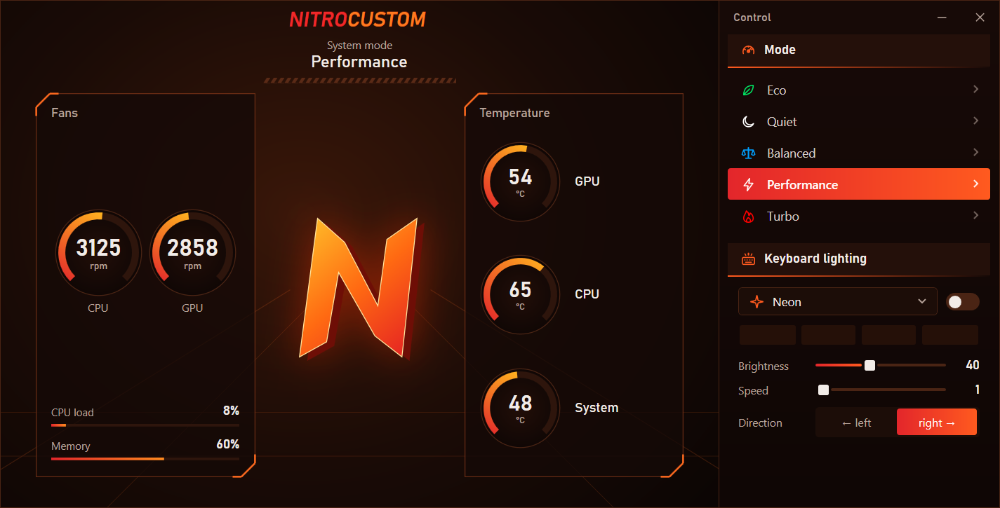
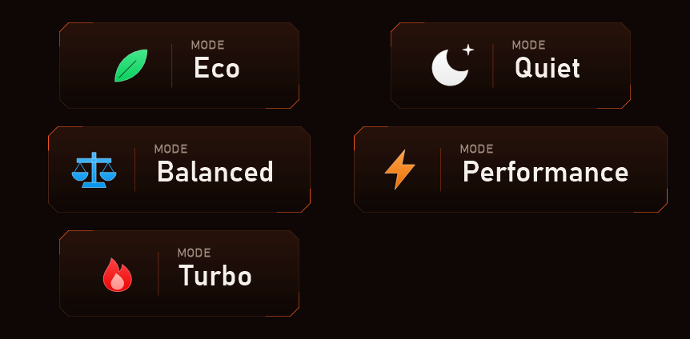

# NitroCustom

A small, local replacement for Acer NitroSense: thermal profiles, keyboard lighting, the Nitro key and live sensors on Acer Nitro laptops, without any Acer software installed.

[Русская версия](README.ru.md)

> **Beta. Read this first.**
> NitroCustom writes to your laptop's firmware through Acer's own WMI interface and the keyboard lighting controller. It has been tested on **one model only: Acer Nitro ANV16S-41, BIOS V1.12**. On any other model the behaviour is unknown, so NitroCustom starts there in **read-only mode**: it shows sensors and the current mode, and writes nothing to the firmware until you click **Allow** in the window. Use it at your own risk, see [docs/SUPPORTED_MODELS.md](docs/SUPPORTED_MODELS.md) and the [MIT license](LICENSE).

## Why NitroCustom

NitroCustom is small on purpose. It switches thermal profiles, sets keyboard lighting and shows the essentials in a window that looks like the NitroSense you already know. No accounts, no network connections. If you want history graphs, fan curves or CPU power limits, [nitrous](https://github.com/jeremyaliparo/nitrous) is the better choice.

## Screenshots

## What it does

| Area | What you get |
|---|---|
| Thermal profiles | Eco, Quiet, Balanced, Performance, Turbo. The saved profile is applied at boot and after sleep |
| Sensors | CPU and GPU temperature, CPU and GPU fan speed, CPU load, memory |
| Keyboard lighting | Static colour and effects (neon, wave, breathing, shifting, zoom, meteor, twinkling), brightness, speed, direction, mode-key colour per profile |
| Nitro key and mode key | The lightning key opens the window, the mode key cycles profiles |
| On-screen notification | A small card with the new profile name when you switch modes |
| Tray | Lives in the system tray, starts with Windows, no UAC prompt on login |
| Safety | On a laptop model that was not verified, everything is read-only until you allow writing |

## Install

1. Download `NitroCustom-Setup-<version>.exe` from the [Releases](../../releases) page.
2. Compare its SHA-256 with the value in the release notes: `Get-FileHash .\NitroCustom-Setup-<version>.exe`.
3. Run the installer as administrator. It installs to `Program Files\NitroCustom`, registers the `NitroCustom` Windows service and starts the tray app.

The installer is **not code-signed**, so Windows SmartScreen may warn you. Everything is built from this repository, see [docs/BUILDING.md](docs/BUILDING.md).

Remove it from Windows Settings, Apps. Your settings stay in `C:\ProgramData\NitroCustom\settings.json`.

## Language

The interface follows your Windows display language: Russian on a Russian Windows, English everywhere else. The installer does the same.

## How it works

Three small processes and one command-line tool:

| Part | Role |
|---|---|
| `NitroCustom.Service` | Windows service (LocalSystem). The only owner of the hardware: talks to the firmware, applies saved settings at boot, resume and power changes |
| `NitroCustom.App` | Tray app and window, runs without administrator rights, talks to the service over a local named pipe |
| `NitroCustom.Agent` | Light helper in your session: Nitro and mode keys, the on-screen notification |
| `nitroctl` | Command-line test tool, useful for diagnostics and for checking a new model |

The code makes no network connections and opens no ports. Parts talk to each other over a local named pipe only.

## Known limitations

— Fan curves are not supported. Fans stay on the firmware's automatic mode.

— Running next to Acer NitroSense or Quick Access is untested. Both want the same keys, so uninstall them first.

— Only the ANV16S-41 is verified, and only on Windows 11. Other models stay read-only until you allow writing.

## Alternatives

If NitroCustom does not fit your laptop, look at [nitrous](https://github.com/jeremyaliparo/nitrous) (MIT, Windows, fan curves and more models). NitroCustom's lighting protocol notes build on its work, see [THIRD-PARTY-NOTICES.md](THIRD-PARTY-NOTICES.md).

## Help us support more models

Run the diagnostics from [docs/SUPPORTED_MODELS.md](docs/SUPPORTED_MODELS.md) and open a hardware report using the issue template.

## Contributing

See [CONTRIBUTING.md](CONTRIBUTING.md) and [docs/ARCHITECTURE.md](docs/ARCHITECTURE.md). The safety rules about writing to firmware are part of the project, please read them first.

## Disclaimer

NitroCustom is an independent project. It is not affiliated with, endorsed by or sponsored by Acer Inc. Acer, Nitro and NitroSense are trademarks of their respective owners. The software is provided as is, without warranty of any kind.
