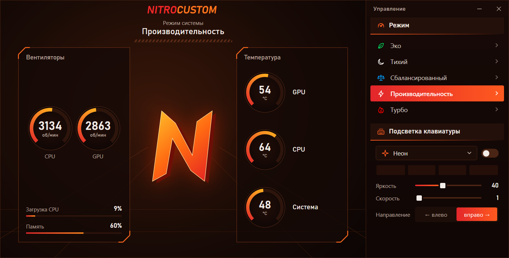
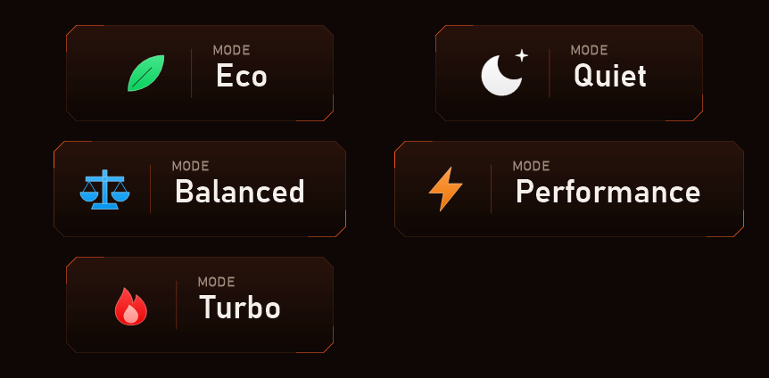

# NitroCustom

Небольшая локальная замена Acer NitroSense: режимы производительности, подсветка клавиатуры, клавиша Nitro и датчики на ноутбуках Acer Nitro, без какого-либо софта Acer.

[English version](README.md)

> **Бета. Прочитай это сначала.**
> NitroCustom пишет в прошивку ноутбука через штатный WMI-интерфейс Acer и контроллер подсветки клавиатуры. Проверено **только на одной модели: Acer Nitro ANV16S-41, BIOS V1.12**. На других моделях поведение неизвестно. Используешь на свой риск, см. [docs/SUPPORTED_MODELS.md](docs/SUPPORTED_MODELS.md) и [лицензию MIT](LICENSE).

## Зачем нужен NitroCustom

NitroCustom маленький намеренно. Он переключает режимы, задаёт подсветку клавиатуры и показывает главное в окне, которое выглядит как знакомый NitroSense. Без аккаунтов и сетевых подключений. Если нужны графики истории, кривые вентиляторов или лимиты мощности CPU, лучше взять [nitrous](https://github.com/jeremyaliparo/nitrous).

## Скриншоты

## Что умеет

| Область | Что есть |
|---|---|
| Режимы | Эко, Тихий, Сбалансированный, Производительность, Турбо. Сохранённый режим применяется при загрузке и после сна |
| Датчики | Температура CPU и GPU, обороты вентиляторов, загрузка CPU, память |
| Подсветка | Статичный цвет и эффекты (неон, волна, дыхание, сдвиг, зум, метеор, мерцание), яркость, скорость, направление, цвет кнопки режимов для каждого профиля |
| Клавиши Nitro | Клавиша с молнией открывает окно, кнопка режимов переключает профили |
| Уведомление | Небольшая карточка с названием нового режима при переключении |
| Трей | Живёт в трее, запускается с Windows, без запроса UAC при входе |

## Установка

1. Скачай `NitroCustom-Setup-<версия>.exe` на странице [Releases](../../releases).
2. Сверь SHA-256 со значением в описании релиза: `Get-FileHash .\NitroCustom-Setup-<версия>.exe`.
3. Запусти установщик от администратора. Он ставит программу в `Program Files\NitroCustom`, регистрирует службу `NitroCustom` и запускает приложение в трее.

Установщик **не подписан**, поэтому SmartScreen может предупредить. Всё собирается из этого репозитория, см. [docs/BUILDING.md](docs/BUILDING.md).

Удалить можно в Параметрах Windows, Приложения. Настройки остаются в `C:\ProgramData\NitroCustom\settings.json`.

## Язык

Интерфейс следует языку отображения Windows: русский на русской Windows, на всех остальных английский. Установщик ведёт себя так же.

## Как устроено

Три небольших процесса и одна консольная утилита:

| Часть | Роль |
|---|---|
| `NitroCustom.Service` | Служба Windows (LocalSystem). Единственный владелец железа: говорит с прошивкой, применяет сохранённые настройки при загрузке, выходе из сна и смене питания |
| `NitroCustom.App` | Приложение в трее и окно, работает без прав администратора, общается со службой через локальный именованный канал |
| `NitroCustom.Agent` | Лёгкий помощник в твоей сессии: клавиши Nitro и режимов, уведомление на экране |
| `nitroctl` | Консольная утилита для диагностики и проверки новой модели |

Код не делает сетевых подключений и не открывает портов. Части общаются только через локальный именованный канал.

## Известные ограничения

— Кривых вентиляторов нет. Вентиляторы остаются на автоматическом режиме прошивки.

— Совместная работа с Acer NitroSense и Quick Access не проверена. Обе программы борются за те же клавиши, поэтому сначала удали их.

— Проверена только модель ANV16S-41 и только на Windows 11.

## Альтернативы

Если NitroCustom не подходит твоему ноутбуку, посмотри [nitrous](https://github.com/jeremyaliparo/nitrous) (MIT, Windows, кривые вентиляторов и больше моделей). Заметки о протоколе подсветки в NitroCustom опираются на его работу, см. [THIRD-PARTY-NOTICES.md](THIRD-PARTY-NOTICES.md).

## Помоги поддержать больше моделей

Выполни диагностику из [docs/SUPPORTED_MODELS.md](docs/SUPPORTED_MODELS.md) и открой отчёт об оборудовании по шаблону.

## Отказ от ответственности

NitroCustom независимый проект. Он не связан с Acer Inc., не одобрен и не спонсируется ею. Acer, Nitro и NitroSense являются торговыми марками их владельцев. Программа предоставляется как есть, без каких-либо гарантий.
